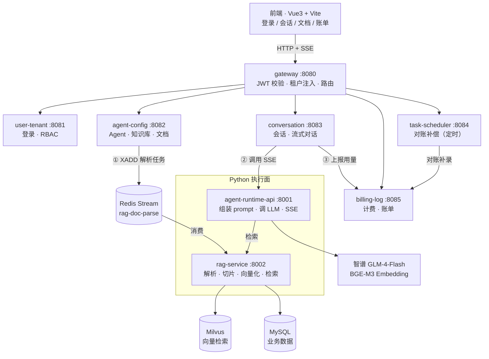

# let-out-house

**企业级 RAG 知识库问答平台** —— 上传文档自动解析入库，提问时先检索知识库再由大模型作答，**答案附带可回溯的引用来源**，全过程 Token 用量可计费、可审计、可对账。

基于 **Java 控制面 + Python 执行面** 的双栈架构：Java 负责权限、事务、配置管理，Python 负责文档解析与向量计算。

<p>
  
  
  
  
  
  
  
  
</p>

---

## 目录

- [为什么做这个项目](#为什么做这个项目)
- [功能特性](#功能特性)
- [系统架构](#系统架构)
- [技术栈](#技术栈)
- [目录结构](#目录结构)
- [快速开始](#快速开始)
- [核心设计](#核心设计)
- [数据模型](#数据模型)
- [接口概览](#接口概览)
- [测试与验证](#测试与验证)
- [Roadmap](#roadmap)
- [常见问题](#常见问题)

---

## 为什么做这个项目

企业内部的文档问答有两个绕不开的诉求：**答案要可信**（能指出依据原文的哪一段）、**成本要算清**（每次问答消耗多少 Token、谁在用）。

市面上的 RAG Demo 大多只做到"能回答"，本项目补齐了工程化部分：

| 维度 | 常见 Demo | 本项目 |
|---|---|---|
| 回答依据 | 只输出文本 | 返回 `citations`（文档名 / 相似度 / 原文片段），落库后刷新历史仍可见 |
| 文档入库 | 同步解析，大文件超时 | 异步队列（Redis Stream），上传 **0.15s** 返回，失败自动重试 + 死信 |
| 用量成本 | 不统计 | 按模型单价计费，幂等上报、故障降级、定时对账补偿 |
| 多租户 | 无 | 三层隔离（网关覆盖 Header → ThreadLocal → MyBatis 拦截器） |
| 验证方式 | 手工点页面 | `smoke-test.sh` 22 项端到端断言，一条命令全绿 |

---

## 功能特性

### 知识库与 RAG

- 支持 `pdf` / `docx` / `md` / `txt` 上传，自动解析、切片、向量化
- 向量存 Milvus，分片元数据存 MySQL，检索时按 `milvus_pk` 回查原文
- 相似度阈值过滤（默认 0.4），Top-K 可配置
- **引用透传**：`end` 事件返回引用数组，正文中的 `[1]` `[2]` 与引用序号对应

### 对话

- SSE 流式输出（`chunk` / `end` / `error` 三类事件）
- 多轮上下文（最近 20 条消息）
- 模型、温度、max_tokens、Top-K 均可按 Agent 配置
- 支持中断（客户端断开时保存半截回答，`msg_status=0`）
- 未配置 LLM Key 时自动降级到 Mock 模式，保证链路可演示

### 文档入库（异步）

- 上传 → 落库（待解析）→ 投递 Redis Stream → **立即返回**
- 消费者完成解析后回写状态：`0` 待解析 / `1` 解析中 / `2` 完成 / `3` 失败
- 可靠性：消费组 + `XACK` + 3 次重试 + 死信队列 + `XAUTOCLAIM` 认领僵尸消息

### 计费与账单

- 按 `input_tokens` / `output_tokens` 与模型单价（元/百万 token）计算费用
- **幂等**：`uk(tenant_id, message_id)` + 前置查询双保险，重复上报只记一条
- **降级**：计费服务不可用只记 WARN，不影响对话主链路
- **对账**：定时任务扫描 `message` 表缺口并补录（`INSERT ... SELECT` 自身也幂等）

### 平台能力

- JWT + 多租户隔离，网关强制覆盖 `X-Tenant-Id` 防伪造
- 统一响应体 `{ code, msg, data, traceId }`，全链路 `traceId` 贯通
- 数据库三账号分工：`loh_migrate`(DDL) / `loh_app`(DML) / `loh_ro`(只读)
- 版本化迁移脚本（`sql/V1~V8`，幂等可重放）

---

## 系统架构



**为什么拆 Java 和 Python**：Java 生态在权限模型、事务、配置中心上更成熟（控制面）；Python 在文档解析（pypdf / python-docx）与向量生态上更顺手（执行面）。两侧以 OpenAPI 契约为界，Python 侧为契约源。

---

## 技术栈

| 层次 | 技术选型 | 说明 |
|---|---|---|
| 语言 / 运行时 | **JDK 21** · **Python 3.11** | Python 虚拟环境由 `uv` 管理 |
| 微服务 | Spring Boot 3.2.12 · Spring Cloud 2023.0.3 · Spring Cloud Alibaba 2023.0.3.2 | 版本矩阵锁定，禁止单独升级 |
| 网关 | Spring Cloud Gateway | JWT 校验、租户注入、路由 |
| 持久层 | MyBatis-Plus 3.5.7 · MySQL 8.0 | 逻辑删除 `deleted=id` 规避唯一键冲突 |
| 缓存 / 队列 | Redis（Stream） | 解析任务队列 + 分布式锁 |
| 向量库 | Milvus 3.0（pymilvus 3.0.2） | 集合按知识库隔离，COSINE 相似度 |
| 执行面 | FastAPI · pymilvus · httpx · pypdf · python-docx | 全异步 I/O |
| Embedding | 硅基流动 `BAAI/bge-m3`（1024 维） | 分批 + 429 重试 |
| LLM | 智谱 `glm-4-flash`（OpenAI 兼容） | `trust_env=False` 防代理劫持 |
| 认证 | JWT（jjwt 0.12.5）+ ApiKey 双认证 | |
| 前端 | Vue 3.5 · Vite · mdui · Tauri 2 | 开发端口 `1420` |
| API 文档 | springdoc-openapi 2.3.0（本地调试用） | |

---

## 目录结构

```
let-out-house/
├── contracts/                 # 前端接口契约（唯一事实源）
│   └── frontend-api.md        # 九章：通用约定/登录/Agent/会话/SSE/文档/计费
├── sql/                       # 版本化迁移脚本，按序执行
│   ├── V1__init_tenant_rbac.sql
│   ├── V2__align_permission_paths.sql
│   ├── V3__init_kb_agent.sql
│   ├── V4__init_conversation.sql
│   ├── V5__document_chunk.sql
│   ├── V6__embedding_model_bge_m3.sql
│   ├── V7__message_citations.sql
│   └── V8__billing.sql
├── scripts/
│   ├── start-all.sh           # 一键启动 8 个服务
│   ├── stop-all.sh            # 一键停止
│   └── smoke-test.sh          # 22 项端到端断言
├── docs/
│   ├── deployment.md          # 部署手册（端口 / 环境变量 / 排查清单）
│   └── interview-notes.md     # 架构一页纸（设计取舍与踩坑）
├── loh-common-starter/        # 公共模块：租户上下文、统一响应、异常、MyBatis 拦截器
├── loh-gateway/               # 网关 :8080
├── loh-user-tenant/           # 用户与租户 :8081
├── loh-agent-config/          # Agent 配置 · 知识库 · 文档管理 :8082
├── loh-conversation/          # 会话 · SSE 流式对话 :8083
├── loh-task-scheduler/        # 定时任务（计费对账） :8084
├── loh-billing-log/           # 计费与账单 :8085
├── python/
│   ├── rag-service/           # :8002 检索 · 入库 · 队列消费
│   └── agent-runtime-api/     # :8001 LLM 调用 · SSE
├── fronted/                   # 前端（Vue 3 + Vite + Tauri）
└── data/documents/            # 上传文件落盘（Java 与 Python 共享）
```

---

## 快速开始

### 前置依赖

| 依赖 | 版本 | 用途 |
|---|---|---|
| JDK | 21 | 运行 Java 服务 |
| Maven | 3.9+ | 构建 |
| Python | 3.11 | 由 `uv` 管理 |
| MySQL | 8.0 | 业务库 |
| Redis | 6+ | 队列与锁 |
| Milvus | 3.0（pymilvus 3.0+） | 向量检索 |
| Node.js / pnpm | 20+ / 9+ | 前端 |

### 1. 初始化数据库

```bash
# 用 DDL 账号按序执行（脚本幂等，可重复跑）
for f in sql/V1__*.sql sql/V2__*.sql sql/V3__*.sql sql/V4__*.sql \
         sql/V5__*.sql sql/V6__*.sql sql/V7__*.sql sql/V8__*.sql; do
  mysql -h <host> -u loh_migrate -p < "$f"
done
```

### 2. 配置环境变量

`python/rag-service/.env`：

```ini
LOH_MYSQL_USER=loh_ro              # 只读：检索回查正文
LOH_MYSQL_PASSWORD=***
LOH_MYSQL_WRITE_USER=loh_app       # 写入：分片落库、状态回写
LOH_MYSQL_WRITE_PASSWORD=***
LOH_REDIS_HOST=127.0.0.1
LOH_REDIS_PASSWORD=***
LOH_STREAM_KEY=loh:stream:rag-doc-parse
LOH_CONSUMER_GROUP=rag-workers
```

`python/agent-runtime-api/.env`：

```ini
LOH_LLM_API_KEY=<智谱 API Key>
LOH_LLM_BASE_URL=https://open.bigmodel.cn/api/paas/v4
LOH_LLM_MODEL=glm-4-flash
LOH_RAG_SERVICE_BASE_URL=http://127.0.0.1:8002
```

### 3. 构建并启动

```bash
# 构建（clean 会删 jar，跑服务前必须 package）
mvn -o clean package -DskipTests

# 一键启动 8 个后端服务（含环境检查与健康探测）
bash scripts/start-all.sh

# 前端
cd fronted && pnpm install && pnpm dev    # → http://localhost:1420
```

启动完成后脚本会打印 8 个服务就绪状态、`/health` 结果与网关登录验证。

**默认账号**：`platform / admin / Admin@12345`

### 4. 一键验证

```bash
bash scripts/smoke-test.sh                    # 服务已启动，22 项断言
bash scripts/smoke-test.sh --with-services    # 自动起停全部服务
bash scripts/smoke-test.sh --skip-llm         # 跳过真实 LLM 调用
```

### 服务端口一览

| 服务 | 端口 | 服务 | 端口 |
|---|---|---|---|
| gateway | 8080 | billing-log | 8085 |
| user-tenant | 8081 | agent-runtime-api | 8001 |
| agent-config | 8082 | rag-service | 8002 |
| conversation | 8083 | 前端（Vite） | 1420 |
| task-scheduler | 8084 | | |

---

## 核心设计

### 1. 引用链路：让答案可回溯

```
检索片段（Top-K）
  → 拼进 system prompt，附 [1] [2] 编号
  → 模型回答自然带 [1]
  → SSE end 事件返回 citations[{index, chunkId, documentName, score, snippet}]
  → 写入 message.citations(JSON)，历史消息回显仍有来源
```

`message` 表用 `citations JSON` 单列而不是拆关联表：引用只用于展示、不做关系查询；出参用 `JsonNode` 避免前端收到转义字符串。

### 2. 上传异步化：0.15 秒返回

改造前同步等解析（大 PDF 3~30 秒，可能顶到 300 秒超时）。改造后：

```
上传 → 存盘 → 落库(parse_status=0) → XADD → 立即返回
                                            ↓
                  消费者：解析 → 切片 → 向量化 → 双写 → 回写(2/3)
```

可靠性五件套：`XGROUP MKSTREAM` 建组、处理完成才 `XACK`、失败计数重试 3 次、超限进死信队列、`XAUTOCLAIM` 认领僵尸消息。

### 3. 计费三道保险

| 问题 | 方案 |
|---|---|
| 重复上报 | 幂等键 `uk(tenant_id, message_id)` + 前置查询双保险 |
| 计费服务挂了 | 上报包 `try-catch` 只记 WARN，对话照常完成 |
| 流水丢失 | 定时对账：`INSERT ... SELECT` 补录缺口，`ON DUPLICATE KEY UPDATE` 保证自身幂等，Redis 锁防多实例重复 |

### 4. 多租户三层隔离

```
JWT 中的 tenantId
  → 网关强制覆盖 X-Tenant-Id（防前端伪造）
  → TenantContext (ThreadLocal)
  → MyBatis 拦截器自动拼 tenant_id（平台表进白名单跳过）

Python 侧无框架兜底：所有 SQL 手写 tenant_id，跨表 JOIN 两张表都带条件
数据库层：所有唯一键前缀 tenant_id
```

### 5. 向量与元数据一致性

- 顺序：先写 MySQL 拿 `chunk_id` → 再插 Milvus 带上 `chunk_id` → 回写 `milvus_pk`
- 覆盖上传：先按 `chunk_id` 删旧向量再重建，避免脏数据
- 删除文档：逻辑删除 + 清向量 + 清分片，`doc_count` 同步递减
- 校验：冒烟测试断言 `sum(milvus_pk=0)=0`

---

## 数据模型

15 张表，按域划分：

| 域 | 表 |
|---|---|
| 租户与权限 | `tenant` `sys_user` `sys_role` `sys_permission` `sys_user_role` `sys_role_permission` |
| 知识与 Agent | `knowledge_base` `agent_config` `agent_kb_rel` |
| 文档与分片 | `document` `document_chunk` |
| 会话 | `conversation` `message` |
| 计费 | `model_price` `token_usage_log` |

关键约定：

- 逻辑删除统一用 `deleted BIGINT`，删除时写入自身 `id`（配合唯一键避免冲突）
- 所有唯一键带 `tenant_id` 前缀
- 向量只存 Milvus；MySQL 只存 `document_chunk` 元数据 + `milvus_pk`

---

## 接口概览

完整契约见 **[`contracts/frontend-api.md`](contracts/frontend-api.md)**（含请求/响应示例与前端接入注意事项）。

| 分组 | 方法与路径 | 说明 |
|---|---|---|
| 登录 | `POST /api/auth/login` | `tenantCode + username + password` |
| Agent | `GET/POST/PUT/DELETE /api/agent/**` | Agent 配置 CRUD，含关联知识库 |
| 会话 | `POST /api/conversation` · `GET /{id}/history` · `DELETE /{id}` | |
| 对话 | `POST /api/conversation/{id}/stream` | **SSE**：`chunk` / `end`（含 citations、tokenUsage）/ `error` |
| 文档 | `POST/GET/DELETE /api/knowledge/{kbId}/documents` | 上传（异步）/ 列表 / 删除 |
| 计费 | `GET /api/billing/summary` · `/detail` | 用量汇总与明细 |
| 运维 | `POST /api/task/reconcile` | 手动触发计费对账补偿 |

统一响应体：

```json
{ "code": 0, "msg": "success", "data": {}, "traceId": "..." }
```

`code = 0` 表示成功；HTTP 状态码恒为 200（网关层 401 除外）。

---

## 测试与验证

`scripts/smoke-test.sh` 覆盖 11 个阶段、22 项断言：

| 阶段 | 断言要点 |
|---|---|
| 环境预检 | MySQL / Redis / Milvus 连通 |
| 服务就绪 | 8 个端口可达 |
| 登录 | 取得 token |
| 上传 | `parseStatus=0` 且耗时 < 3s |
| 消费 | `parse_status` 变 2、`chunk_count > 0` |
| 检索 | 新文档被命中（按文件名断言） |
| 对话 | `end` 事件含 `fullContent` / `citations` / `tokenUsage` |
| 计费 | `token_usage_log` 有对应 `message_id` |
| 对账 | 补偿任务返回 0（无缺口） |
| 删除 | 分片清空 |
| 一致性 | `kb.doc_count` 与真实文档数一致、计费无缺口 |

```
================ 结果 ================
  通过 22 / 失败 0
  全部通过 ✅
```

---

## Roadmap

- [x] 多租户 RBAC 与 JWT 鉴权
- [x] Agent 配置与知识库关联
- [x] SSE 流式对话 + 引用透传
- [x] 文档上传解析入库
- [x] 上传异步化（Redis Stream）
- [x] Token 计费与对账补偿
- [ ] 混合检索（向量 + BM25 融合），提升专有名词命中率
- [ ] 引用校验：校验回答中的 `[n]` 是否存在于 citations，做幻觉检测
- [ ] 文档解析进度实时推送（SSE / WebSocket）
- [ ] Prometheus 指标 + Grafana 面板（actuator 已开启）
- [ ] 多模态：图片 / 扫描件 OCR

---

## 常见问题

| 现象 | 原因 | 解决 |
|---|---|---|
| 上传后 `parseStatus` 一直是 0 | rag-service 未启动 / 消费者未运行 | 看 `logs/rag-service.log` 是否有 `[consumer]已启动`；`XPENDING` 查积压 |
| 检索不到刚上传的文档 | `document_chunk.milvus_pk=0`，回查失败 | 检查解析流程是否完整跑完，重传即可 |
| Python 服务报 `No module named 'rag_service'` | 启动目录不对 | 必须在 `python/rag-service` 下启动（脚本已处理） |
| 内部 HTTP 报 `Expecting value: line 1 column 1` | 本机代理劫持 `127.0.0.1` | httpx 使用 `trust_env=False`；命令行 `env -u http_proxy` |
| `Unknown column 'tenant_id'` | 平台级表被租户拦截器拼条件 | 加入 `CustomTenantLineHandler.IGNORE_TABLES` |
| `TenantMissingException`（定时任务） | 无 HTTP 上下文 | Mapper 方法加 `@InterceptorIgnore(tenantLine="true")` |
| LLM 返回 429 `code=1302` | 免费档限流 | 换 `glm-4-flash` 或错峰调用 |
| 网关新路径 404 | yml 改了但 jar 未重打 | 重新 `mvn package -pl loh-gateway` |

更多排查见 [`docs/deployment.md`](docs/deployment.md)。

---

## 贡献

欢迎提 Issue / PR。提交前请确保：

```bash
mvn -o clean package -DskipTests          # 编译通过
bash scripts/smoke-test.sh                # 22 项断言全绿
```

接口变更请同步更新 `contracts/frontend-api.md`（契约是唯一事实源）。

## License

当前仓库尚未声明开源许可证。如需对外开源，建议补充 `LICENSE`（如 MIT / Apache-2.0）。
